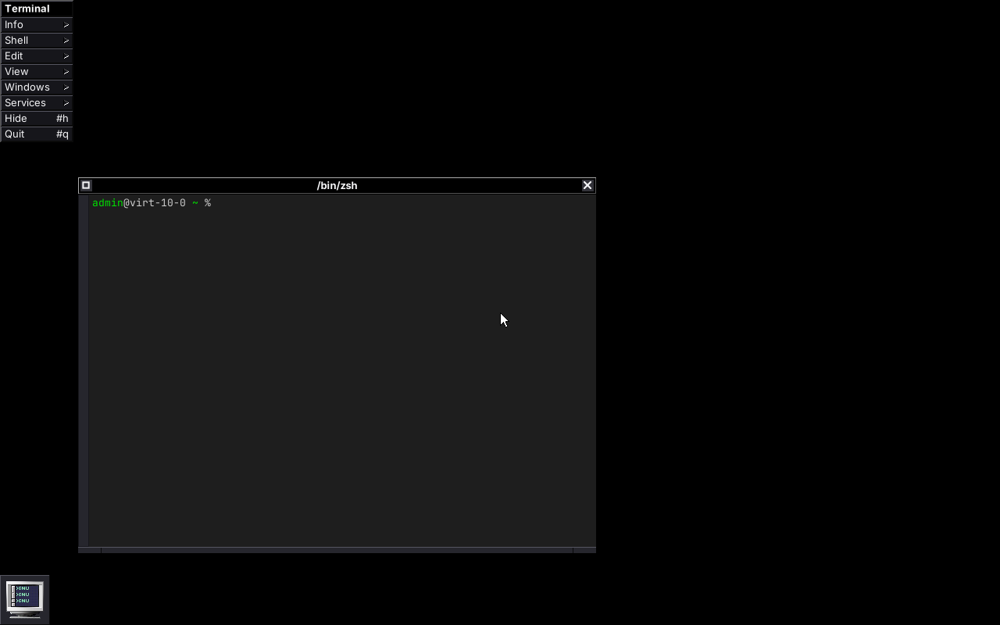
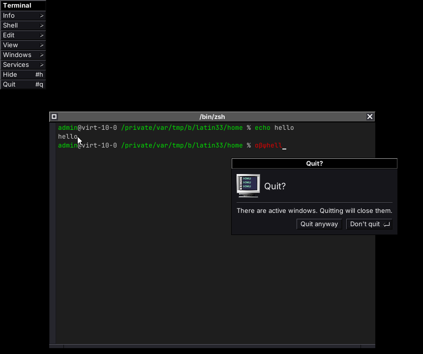
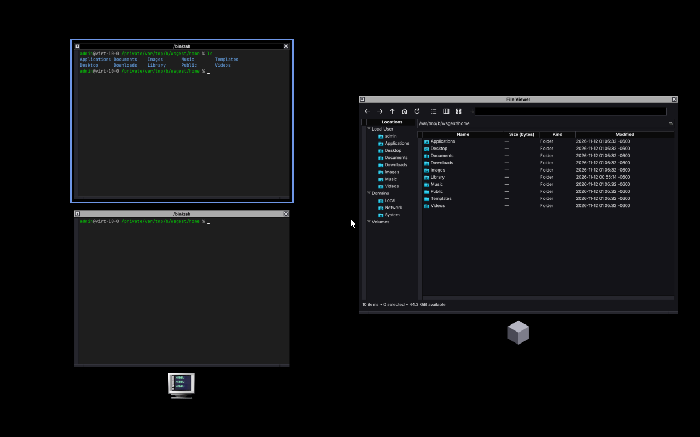
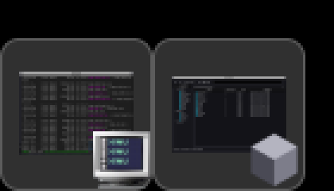
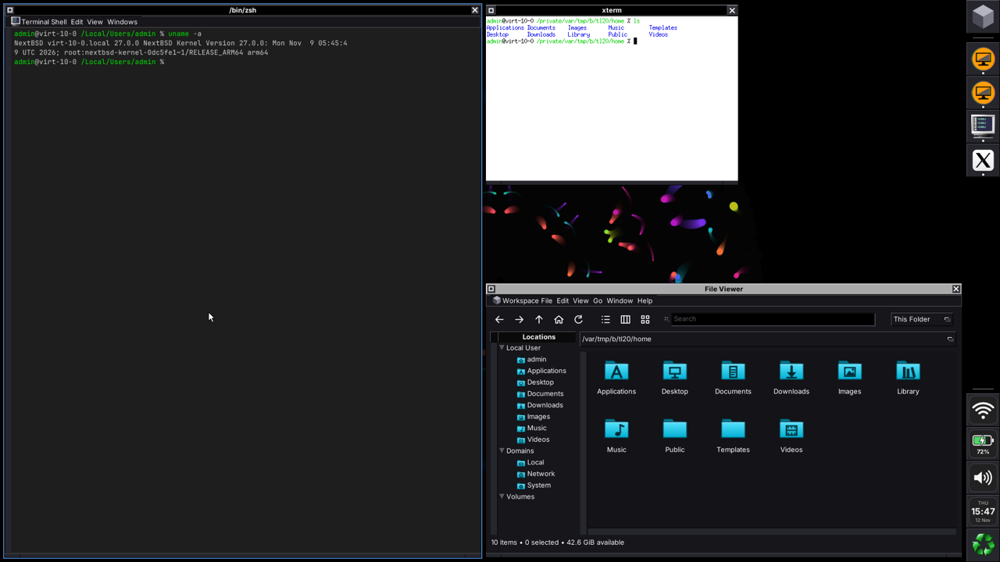
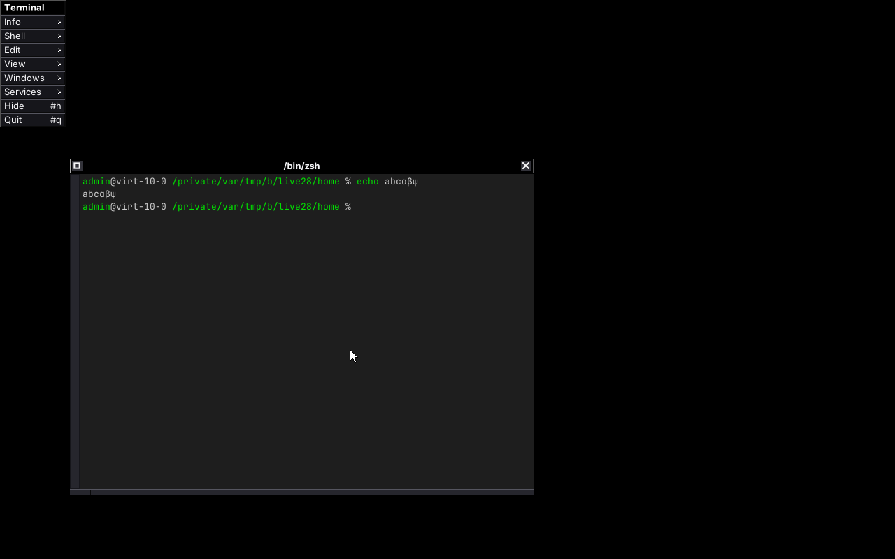

# apps-windowserver

WindowServer for NextBSD: a native display server in the style of NeXTSTEP's and macOS's Window Server.

It owns the screen, input, window ordering and application activation. GNUstep apps draw their own windows and hand the finished pixels to WindowServer, which composites them. There is no X11 and no Wayland in between. XLibre stays available for X11 apps.

This is a proof of concept. It isn't usable yet.



Terminal running on WindowServer through the GNUstep `nextbsd` backend, captured in headless mode with `wsctl snapshot`.

## NextBSD only

WindowServer is built on what NextBSD provides, and isn't meant to run anywhere else:

- **launchd** starts it at boot as a LaunchDaemon. Each user's session apps are LaunchAgents.
- **Mach** carries messages between apps and the server. Apps find it as a Mach service through the bootstrap.
- **IOKit** reports GPUs, displays and input devices as they appear.
- **DRM/KMS** from NextBSD's kernel extensions drives the display, with Mesa's EGL and GBM for GPU compositing.
- **libinput** and **libxkbcommon** read the keyboard, mouse and touchpad.

## How the pieces fit

| Piece | Repository | What it does |
|---|---|---|
| WindowServer | this repository | The daemon: display, input, compositing, window levels, focus and the active app |
| `nextbsd` backend | [nextbsd/libs-back](https://github.com/nextbsd/libs-back) | The GNUstep backend each app loads (`libgnustep-nextbsd`). It draws with cairo into shared buffers and talks to WindowServer over Mach |
| Build script | [pkgdemon/nextbsd-gnustep](https://github.com/pkgdemon/nextbsd-gnustep) | `build-windowserver.sh` builds the backend and WindowServer on top of the GNUstep core libraries |

libs-base and libs-gui are unmodified. The `nextbsd` backend installs beside the stock X11 backend, and the `GSBackend` default chooses between them, per app or for the whole session.

## Where it installs

| What | Path |
|---|---|
| Server | `/System/Library/CoreServices/WindowServer` |
| launchd job | `/System/Library/LaunchDaemons/org.nextbsd.WindowServer.plist` |
| Defaults | `/System/Library/Preferences/org.nextbsd.WindowServer.plist` |
| Client library | `/usr/lib/libWindowServerClient.so.1` and `.a` |
| Headers | `/usr/include/WindowServer/` |
| pkgconf file | `/usr/libdata/pkgconfig/WindowServerClient.pc` |
| Test tools | `/usr/libexec/WindowServer/` (`wstest`, `wspointer`, `wstiling`, `wsdrag`, `wsctl`, `ws-session`) |
| Client socket | `/var/run/WindowServer/ws.sock` |
| Account | `_windowserver` (uid 88) |

WindowServer starts as root to open the GPU and input devices, then runs as `_windowserver`. If that account doesn't exist yet, it says so and stays root.

The client library is a plain C library with no dependencies beyond libc and NextBSD's Mach libraries, so it goes in `/usr/lib` with its headers in `/usr/include`, next to libdrm and libinput. The GNUstep backend links it with `pkgconf --libs WindowServerClient`.

## Status

Phase 1, the software path, is written. The server, the client library and two test tools build, and the headless test passes on the arm64 VM. The DRM, VT and libinput code builds but hasn't run on real hardware yet. There is no GNUstep backend yet, so no real apps can use it. This is still a proof of concept.

What works, tested headless:

- The Mach service, the per-client socket and buffer passing.
- Windows stacked strictly by level (the libs-gui `NSWindowLevel` numbers), then by order within a level.
- One active app. A click in an inactive app's window deactivates the old app, activates the new one, raises the window, makes it key, and then delivers the click.
- Keys go only to the key window of the active app, with server-side key repeat.
- Damage-tracked compositing with pixman, buffer release and frame-done events.
- Minimized windows as live tiles along the bottom of the screen (see [Minimized windows](#minimized-windows)).
- The usable area, the screen minus the active app's Mac-style menu bar and the Dock's strip, sent to every app, and screen size changes (see [The screen and its usable area](#the-screen-and-its-usable-area)).
- The Dock's view of every app's windows, with change notices, activation, restoring and previews (see [The Dock](#the-dock)).
- Built-in images for every standard cursor kind: arrow, I-beam, pointing, open and closed hand, crosshair, left-right and up-down resize, and not allowed. A kind the server doesn't know shows the arrow.
- Snapshots and synthetic input for testing.
- Touchpad scroll phases and momentum scrolling, with synthetic two-finger scrolls (see [Touchpad](#touchpad)).
- The window overview, Exposé and App Exposé, opened by a Start tap, Control+Up/Down, the Mission Control key or a three-finger swipe (see [The overview](#the-overview)).
- Settings that change while the server runs, per console user: keyboard layouts (a list, switched by a request or a shortcut), key repeat, pointer and touchpad settings (see [Settings](#settings)).
- Window tiling, switched on and off live, with the dwindle and master-and-stack layouts, gaps, an active-window border, floating windows, keys and the pointer (see [Window tiling](#window-tiling)).
- Drag and drop between apps, mediated by the server, with the image above every window and the Dock and the cursor showing the operation (see [Drag and drop](#drag-and-drop)).

Written but only compiled:

- DRM/KMS output. It picks the card that has a connected display, sets the preferred mode, uses two dumb buffers with page flips (or `drmModeSetCrtc` if flips fail), and the hardware cursor, with a software cursor as fallback.
- VT handling: no VT switching. The server takes over the VT that is on screen when it starts, puts it in `KD_GRAPHICS` and `K_RAW` with a raw termios, and locks switching with `VT_LOCKSWITCH`, so Ctrl+Alt+F*n* and `vidcontrol -s` can't take the screen away. It refuses to start if that VT is already in graphics mode or controlled by another process (Xorg, or another WindowServer). On exit, `SIGTERM`/`SIGINT` or a crash it unlocks switching, gives the same VT back its VT mode, `KD_TEXT`, keyboard mode and termios, and drops DRM master, so the console comes back as it was.
- libinput on seat0 through the IOKit libudev, with xkbcommon (`evdev` rules), relative and absolute pointers, wheel and touchpad scrolling, and the touchpad settings in [Touchpad](#touchpad). Power and sleep keys are logged, never typed.
- Dropping from root to `_windowserver` after the devices are open.

Not done yet:

- The GNUstep backend (`libgnustep-nextbsd` in the libs-back fork) and a real `ws-session`.
- Waiting for the GPU kext's IOKit match, and display hotplug through IOKit.
- Touch, tablets, gestures other than swipes up and down, and switches. Per-device keyboard settings.
- Skipping windows hidden behind opaque ones while compositing.
- GPU compositing (EGL/GBM), several displays, HiDPI.
- A focus-stealing policy: today any app can make itself active.
- loginwindow, the lock shield and the app switcher. Their window levels are reserved.

## Building

On NextBSD, with the base display stack (libdrm, libinput, libxkbcommon, pixman) and gmake:

```sh
gmake
gmake check          # the headless test, see below
gmake install        # DESTDIR=... and the *DIR variables in GNUmakefile work
```

Everything is built into `build/`.

## Trying it without a display

Headless mode needs no GPU, VT or input devices and no privileges, so it runs anywhere, including over SSH while X is using the screen:

```sh
build/WindowServer --headless 1280x800 &
build/wstest &                 # apps Alpha and Beta (+ Gamma, joined to Alpha), four windows
build/wsctl list               # the window stack, bottom to top
build/wsctl pixel 350 300      # the colour on screen at 350,300
build/wsctl click 150 450      # click into Alpha's window
build/wsctl key a              # type "a" into the active app
build/wsctl snapshot out.ppm   # save the screen
build/wsctl screen size 1024x600  # change the headless screen's size
```

`wstest` prints every event it gets. `tests/headless-test.sh` (`gmake check`) does all of this with its own service name and socket, and checks the screen colours, the order of the activation events, that only the active app gets keys, joining an app, the XKB events, XRGB8888 buffers, restack notices, and minimizing: the tile's picture, icon and live update, selecting and dragging it, and restoring the window with a double-click. It also checks the Dock's requests (`wsctl dock`): that apps can't list other apps' windows, the list with app ids, change notices, minimized windows going into the Dock instead of tiles, each request choosing the Dock or the bottom row (and moving an already minimized window), falling back to the bottom row with no Dock, previews, activating and restoring from the Dock, and the tiles coming back when the Dock goes away. Then the usable area: that every app gets it in the welcome and hears each change once as a Dock reports the bottom, left and top edge and goes away, that the tile moves above a bottom Dock and right of a left one, that a dragged tile stops at the Dock's strip and stays put when the Dock moves; the menu bar strip (`wsctl menubar`): an active app's bar coming off the top, carried in the welcome, a top Dock below it, an inactive app's report not counting, an active app that never said keeping the strip, a 0 report clearing it, the kept report counting again on activation, a too tall bar refused, and the strip going with its app; and screen changes (`wsctl screen size`): screen-changed, then usable-area, to every connection, windows that no longer fit moved back onto the screen with their owners told, the tiles kept on it, and a too small size refused. Then it checks touchpad scrolling: a two-finger flick's phases, momentum that slows down and stops when a finger rests on the touchpad, and no momentum when the fingers stopped before lifting. Last, the overview: opening it with a Start tap (animated), Control+Up, the Mission Control key and three-finger swipes, but not with Command+Q or Start held over a click; its layout (every app's windows, grouped by app, active app first, minimized ones included, menus left out, nothing overlapping, on screen), the dimmed desktop and live previews; keys and clicks going to no app; the arrow keys and Return, a click on a preview (which restores a minimized window), App Exposé, Escape, a second Start tap and a click on empty space.

`tests/pointer-test.sh` (also run by `gmake check`) runs `wspointer`, two apps that use what X servers need from WindowServer, and checks windows created without a round trip each, a window's own cursor showing the moment the pointer enters it, input regions (clicks passing through part of a window to the desktop or the window below), pointer grabs (everything to the grabbing app with window 0 outside its windows, `pointer-outside` on an outside press, nothing activated, another app refused; the grab ended by the overview and by another app's activation; popup grabs that end on the first outside press), pointer tracking only while the app is active, warps (only over the app's own window) and queries (only for the active app), and a resize carried in its commit.

`tests/tiling-test.sh` (also run by `gmake check`) runs `wstiling`, two apps whose windows redraw at whatever size they're given, and checks window tiling: stacking by default with the tiling keys reaching the app, tiling switched on live, the dwindle layout's tiles and gaps, the windows' new frames and redraws, a panel and a `WS_WINDOW_NO_TILE` window floating above the tiles, the border, focus, swap, grow and shrink with the keys and `wsctl tiling`, floating a window and tiling it again (with its old frame back meanwhile), a panel refused, dragging a split, dragging a window onto another tile and back onto its own, the master layout, refused settings, a Dock on the right and at the bottom, no gaps, windows hidden, shown, created, minimized and closed, a window whose minimum size doesn't fit, one that insists on a larger frame, one that sizes itself in steps, one that only moves (as an X server's do), a screen change, and tiling switched off with every frame given back.

`tests/drag-test.sh` (also run by `gmake check`) runs `wsdrag`, two apps with six windows, and checks drag and drop: a drag from Alpha onto Beta's window that takes a copy and one inside Alpha that takes a move, the operations each side offers and the modifiers narrowing them, the drag image following the pointer above the windows, the copy and link cursors, the drag state from `wsctl drag`, the release reaching the source before the end of the drag, a window that takes nothing and one that doesn't take drags (the image slides back), Escape cancelling, the overview staying shut during a drag, and who may start one.

`kill -USR1` makes the server write a snapshot to `/tmp/WindowServer-snapshot.ppm`.

## Running it on the display

Don't do this while Xorg is running: X owns the display. Log in on the text console you want to use, and as root:

```sh
ws-session --server build/WindowServer
```

`ws-session` loads a temporary launchd job for the server, so its Mach service is in the system bootstrap where every user's apps can find it, and stops it on Ctrl-C. The server takes over the VT that is on screen, the one you typed the command on, and VT switching stays locked while it runs. `Ctrl+Alt+Backspace` stops the server (the `AllowTerminate` default) and gives that console back as it was. From SSH, `ws-session stop` or `kill` (`SIGTERM`, not `SIGKILL`: a killed server can't restore the console) do the same. It only starts the server. A full desktop on it (gpbs, gdnc, the Dock, Workspace) comes from [loginwindow](https://github.com/nextbsd/apps-loginwindow)'s session.

You can also start `WindowServer` directly. That works too, but launchd then registers the Mach service in your own login's bootstrap, so only your own processes can find it.

The installed LaunchDaemon ships `Disabled`, because it would otherwise take the console at boot. `launchctl load -F` starts it. launchd-842 only gives the console to a job labelled `com.apple.WindowServer` (core.c, around line 2226), so `org.nextbsd.WindowServer` needs a small launchd patch before it can run as the real console owner.

## How apps talk to it

Apps use `libWindowServerClient` (`<WindowServer/WSClient.h>`). The wire format is in `<WindowServer/WSProtocol.h>`.

- **Mach** carries the requests: hello, create and destroy windows, frame, level, ordering, title, flags, attach a buffer, damage, commit, make key, cursor, activate and deactivate. Apps find the server by looking up `org.nextbsd.windowserver` (or `$WS_SERVICE_NAME`) in the bootstrap. The server reads each sender's pid from the Mach audit trailer.
- **A Unix socket** carries what Mach can't yet. NextBSD's Mach can't pass file descriptors or shared memory, so window buffers are memfds sent over the socket, and the server sends its events there too: input, key window and app activation changes, buffer release, frame done and screen info. Apps get one file descriptor to poll. The hello reply over Mach tells the app where the socket is and gives it a one-time token to connect with.

Window buffers are premultiplied ARGB8888, drawn by the app (with cairo, in the GNUstep backend), or XRGB8888 (`ws_buffer_create_format()`, `WS_FORMAT_XRGB8888` in `ws_sock_buffer_t.format`), whose top byte is ignored and whose window is always composited opaque, as an X server's depth-24 windows need. Servers that take XRGB8888 set `WS_SERVER_XRGB`. After a buffer is sent once, each frame only sends damage rectangles and a commit.

### One app, several connections

Each connection is normally an app of its own. A helper process can join another connection's app instead, so that, for example, the X server XLibre.app starts and XLibre.app itself are one app:

- The app passes its client id and token (`ws_client_id()`, `ws_client_token()`; in GNUstep, `-[NextBSDServer windowServerAppCredentials]`) to the helper, which connects with `ws_connect_join()`. On the wire this is `WS_CONNECT_JOIN` in `ws_req_hello_t.flags` plus `join_client` and `join_token`, an optional tail older clients don't send. The hello reply's `app_id` names the app the connection belongs to.
- Only a process given the token can join; a wrong id or token fails the hello with `EPERM`. Servers that can do this set `WS_SERVER_JOIN`; older ones leave `app_id` 0, and `ws_connect_join()` fails with `ENOTSUP`.
- All connections of an app are activated and deactivated together (`WS_EVENT_APP_ACTIVATED`/`DEACTIVATED` go to each). They share one key window, which can be any connection's window; clicking a joined connection's window only moves the key window. Key events go to the connection that owns the key window, except Command shortcuts: when that is a joined connection, a key pressed with Command held goes to the app's own connection (with window 0), so its menus get it, and so do that key's repeats and release.
- If the app's first connection goes away, the oldest remaining connection carries the app on.

### Command shortcuts with any layout

While a layout that isn't Latin (Greek, Russian...) is active, a key pressed with Command held carries the keysym and text of the first Latin layout in `KeyboardLayout`, or of `us` when the list has none, so Command+C still copies and Command+Q still quits, as on macOS. A layout counts as Latin when its letter keys type a to z (QWERTY, QWERTZ, AZERTY and Dvorak all do). Typing, Option and Control keep the active layout, and so do `WS_CONNECT_XKB` connections, which read raw keycodes with their own keymap. GNUstep apps get this through the `nextbsd` backend without a change to it. Servers that do this set `WS_SERVER_LATIN_SHORTCUTS`.



### XKB state for X servers

Key events carry the keycode, the keysym, text and six coarse `WS_MOD_*` bits, which is all a GNUstep app needs. A client that runs its own XKB, such as an X server, connects with `WS_CONNECT_XKB` (servers that support it set `WS_SERVER_XKB`) and also gets:

- `WS_EVENT_KEYMAP` (`ws_event_keymap_t`), right after the welcome and again if the keymap changes: the compiled keymap (`xkb_keymap_get_as_string()`, text v1, NUL-terminated) in a sealed, read-only memfd passed like a snapshot's, plus the repeat delay and interval in milliseconds. The client maps it with `MAP_PRIVATE` and closes the descriptor.
- `WS_EVENT_MODIFIERS` (`ws_event_modifiers_t`): depressed, latched and locked modifiers and the effective layout group as XKB masks, like Wayland's `wl_keyboard.modifiers`, after any key that changes them.
- `WS_EVENT_KEYS_HELD` (`ws_event_keys_held_t`): the XKB keycodes still held down when the connection starts getting key events (its app is activated, or the key window moves to one of its windows), followed by `WS_EVENT_MODIFIERS`. Their key-ups come to it later, so nothing sticks.

Clients without the flag get none of these.

### Restack notices

When the server itself moves a window in the stack or orders it out (today that is RaiseOnClick), it sends the window's owner `WS_EVENT_WINDOW_ORDERED` (`ws_event_ordered_t`): `WS_ORDER_ABOVE` with the owner's own nearest visible windows below and above it, or `WS_ORDER_OUT`. A client's own ordering, level and destroy requests never cause one. An X server uses it to keep its stacking order right; clients that don't care ignore it. Servers that send it set `WS_SERVER_ORDERED`.

### What X servers need

An X server (`Xnextbsd`, nextbsd/apps-xlibre) is one connection that shows many X clients' windows, and X has grabs, warps, per-window cursors and shaped windows. These are optional: each has a `WS_SERVER_*` flag, older servers ignore the requests, and the client library returns `ENOTSUP` or falls back. The details are in `WSProtocol.h`.

- **Pointer grabs** (`WS_SERVER_POINTER_GRAB`): `ws_pointer_grab(c, WS_GRAB_POINTER)` sends every pointer event to the grabbing connection, wherever the pointer is, until `ws_pointer_ungrab()`: X's active grabs, which click-release-click menus need. Over its own windows events are about them, enter and exit included; over anything else `hdr.window` is 0 and x, y are the screen position. A press activates, raises and makes key nothing, and a press outside its windows first sends `WS_EVENT_POINTER_OUTSIDE`. `WS_GRAB_OUTSIDE` is the lighter popup grab: events go where they would, and the first press outside the connection's windows sends `WS_EVENT_POINTER_OUTSIDE` and ends the grab. Only the active app may grab (`EPERM`), one connection at a time (`EBUSY`). WindowServer ends a grab itself with `WS_EVENT_POINTER_UNGRABBED` when another app is activated (Command-Tab, the Dock) or the overview opens, so a stuck client can't keep the pointer.
- **Warp, query and tracking** (`WS_SERVER_POINTER_WARP`): `ws_warp_pointer()` moves the pointer, only for the active app while the pointer is over one of its windows or it holds the grab. `ws_query_pointer()` gives the position, buttons, modifiers and the connection's own window under the pointer, to the active app or a connection under the pointer. `ws_pointer_track(c, 1)` sends `WS_EVENT_MOUSE_MOVED` with window 0 over everything else while the app is active, so X knows where the pointer is (xeyes).
- **A cursor per window** (`WS_SERVER_WINDOW_CURSOR`): `ws_window_set_cursor()` gives one window its own cursor, which wins over the connection's while the pointer is over it, so the right cursor shows the moment the pointer enters, before the client has seen the motion. `WS_CURSOR_INHERIT` takes it away. Windows may share a cursor buffer, and the server keeps its own reference.
- **Input regions** (`WS_SERVER_INPUT_REGION`): `ws_window_set_input_region()` says which window-local rectangles take pointer events (X Shape's input shape); elsewhere the pointer goes through to what is below. `NULL` makes the whole window take them again. The visible shape comes from the buffer's alpha.
- **Frame and buffer in one commit** (`WS_SERVER_COMMIT_FRAME`): `ws_window_commit_frame()` commits the attached buffer and the window's new frame together, so a resize never shows the new size with the old picture or the other way round.
- **Window ids chosen by the client** (`WS_SERVER_WINDOW_IDS`): `ws_window_create_nowait()` creates a window without waiting for the server. The library reserves a block of ids with `WS_MSG_RESERVE_WINDOW_IDS` (one round trip per 256 windows) and names each new window's id in a one-way `WS_MSG_WINDOW_CREATE`; failures come back as `WS_EVENT_ERROR`.

### Touchpad

Two-finger scrolling works as on a Mac. Servers that do this set `WS_SERVER_SCROLL_PHASES`.

- **Scroll phases.** `ws_event_scroll_t` has two fields at its end, `phase` and `momentum_phase`, with the `NSEventPhase` values (`WS_SCROLL_PHASE_*`). A touchpad scroll (`WS_SCROLL_FINGER`) is one `BEGAN` event, `CHANGED` events, and an `ENDED` event with no delta when the fingers lift. All of it goes to the window the scroll started over. Wheel and other scrolls have both phases `NONE`. Older clients read the event without the new fields, and older servers send it without them, so they read as 0 (`NONE`). `WS_PROTOCOL_VERSION` stays 1.
- **Momentum scrolling.** If the fingers were still moving when they lifted, the scroll carries on from their speed and slows down with friction, about 1.5 s after a fast flick: events with `phase` `NONE` and `momentum_phase` `BEGAN`, `CHANGED`..., then `ENDED` with no delta. It stops at once when a finger touches the touchpad again (libinput's hold gesture, a new scroll, pointer motion or a click). Apps that don't look at the phases just see more scroll events.
- **Clicks.** Tapping is a click (one finger left, two right, three middle); tap and drag is on, without drag lock. A two-finger click is a secondary click (libinput's clickfinger method), or a click in the bottom-right corner, or neither, as `SecondaryClick` says.
- **Three-finger drag**, macOS's accessibility option, is off by default. When it's on, libinput turns three-finger swipes into four-finger ones, and the WindowServer gestures that use three fingers need four.

| Key | Default | |
|---|---|---|
| `TapToClick` | `true` | Tap to click. |
| `TapToDrag` | `true` | Tap, then drag (no drag lock). |
| `SecondaryClick` | `TwoFingers` | `TwoFingers` (a two-finger click or tap), `BottomRightCorner`, or `Off` (every touchpad click and tap is a left click). |
| `ThreeFingerDrag` | `false` | Drag with three fingers without clicking. |
| `MomentumScrolling` | `true` | Scrolling carries on after the fingers lift. |
| `NaturalScrolling` | `false` | Content follows the fingers. |
| `PointerSpeed` | `0` | libinput's pointer acceleration speed, -1 (slowest) to 1, for every pointing device. |
| `TrackpadSpeed` | empty | The touchpad's speed, -1 to 1; empty uses `PointerSpeed`. |
| `MouseSpeed` | empty | The speed of other pointing devices (mice, trackpoints), -1 to 1; empty uses `PointerSpeed`. |
| `MouseAccelProfile` | `adaptive` | Pointer acceleration for mice: `adaptive` (on) or `flat` (off). Touchpads keep libinput's own. |
| `LeftHanded` | `false` | Swap the primary and secondary buttons, on every device that can. |
| `ScrollSpeed` | `1` | Multiplies the scroll distance (touchpad, trackpoint and wheel pixel deltas, not the wheel's detents). |

All of these change while the server runs (see [Settings](#settings)). `wsctl devices` (`ws_list_input_devices()`) lists the input devices, each marked keyboard, pointer, touchpad or mouse, so Trackpad and Mouse settings can say when there is none.

`wsctl scroll DX DY finger` injects one two-finger scroll step (`0 0` lifts the fingers), `wsctl flick DX DY [STEPS]` a quick two-finger scroll and lift, and `wsctl hold` fingers resting on the touchpad, like the rest of the synthetic input: on a headless server, or for root and the server's own user.

### The overview

Exposé and Mission Control, without workspaces yet: WindowServer shows every window at once, and apps don't change. Servers that have it set `WS_SERVER_OVERVIEW`.



- **Opening it.** Tap the Start key on its own (pressed and released with no other key or click in between, so Command shortcuts work as before; `StartKeyShowsOverview`), press Control+Up or the Mission Control key (`KEY_SCALE`, F3 on Apple keyboards), or swipe up with three fingers.
- **App Exposé.** Control+Down or a three-finger swipe down show only the active app's windows. A swipe up from there shows every window.
- **What it shows.** Every normal and floating window, visible or minimized, as a live scaled-down preview that follows what the app draws. Windows are grouped by app, the active app first, with the app's icon (`WS_MSG_SET_APP_ICON`) under each group. They're laid out without overlap and never enlarged, in as many group columns as give the largest previews. Desktop-level windows stay, dimmed; menus, the Dock, app icons and tiles fade out. WindowServer draws no text, so there are no titles. A workspace strip comes with workspaces (#13).
- **Choosing.** Hovering or the arrow keys (and Tab) select a window. A click or Return activates its app with that window in front and key, or restores a minimized one as its tile does. Escape, a click on empty space, Control+Up again or another Start tap close the overview. While it's open, no app gets pointer or key events, except modifier keys.
- **Animation.** Windows move from their places into the overview and back, about 0.25 s with an ease-out, while the desktop dims. `ReduceMotion` turns the animations off.
- **Three-finger drag.** With `ThreeFingerDrag` on, the swipes take four fingers.

| Key | Default | |
|---|---|---|
| `StartKeyShowsOverview` | `true` | A tap of the Start key on its own opens and closes the overview. |
| `ReduceMotion` | `false` | No animations. |

`WS_MSG_OVERVIEW` (`ws_overview()`, from `WS_CONNECT_CONTROL` and `WS_CONNECT_DOCK` connections, with the window list's user check) opens it (`WS_OVERVIEW_ALL`, `WS_OVERVIEW_APP`), closes it (`WS_OVERVIEW_CLOSE`) or only asks (`WS_OVERVIEW_QUERY`). It's answered with `WS_EVENT_OVERVIEW_STATE`, then a `WS_EVENT_OVERVIEW_ITEM` for each window with where its preview and its group's icon are, then `WS_EVENT_LIST_END`. Dock connections get `WS_EVENT_OVERVIEW_STATE` when it starts opening and when it has closed.

`wsctl overview [all|app|close|status]` does this from the command line, and `wsctl swipe FINGERS DX DY [STEPS]` injects a touchpad swipe, like the rest of the synthetic input.

### Minimized windows

WindowServer minimizes windows itself, macOS-style, instead of leaving each app to draw a miniwindow. A minimized window becomes a tile in the bottom row of the screen: a scaled-down picture of the window's current buffer with the app's icon in the bottom-right corner, and no text. The tile is redrawn from every frame the app commits, so a window that keeps drawing while it's minimized (Terminal with output arriving) stays live, and one that stops shows its last frame. Servers that do this set `WS_SERVER_MINIMIZE`.



- `WS_MSG_WINDOW_MINIMIZE` (`ws_window_minimize()`): a bare request naming the window. WindowServer orders the window out and shows its tile, placed like app icons: the first free place along the bottom of the screen, left to right, then the row above.
- **Where it goes, per request.** On servers with `WS_SERVER_MINIMIZE_WHERE`, `ws_window_minimize_where()` also says where the window goes, so each app follows its own user's setting live instead of one server-wide default: `WS_MINIMIZE_INTO_DOCK` hands it to the Dock while a Dock that shows minimized windows is connected and puts its tile on the bottom row otherwise (it moves into a Dock that connects later and back to the bottom row when the Dock goes); `WS_MINIMIZE_BOTTOM_ROW` always gives it a tile, even with a Dock connected; `WS_MINIMIZE_DEFAULT` and a bare request mean what `MinimizeIntoDock` says. Minimizing a window that's already minimized moves it. The request is then a `ws_req_int_t`; the library sends the bare request to older servers.
- `WS_MSG_SET_APP_ICON` (`ws_set_app_icon()`): the app icon for the tiles, a premultiplied ARGB8888 buffer of at most `WS_MAX_APP_ICON` (512) pixels square, which the server copies. A connection that joined an app and has no icon of its own uses the app's.
- One click on a tile selects it, a drag moves it, and a double-click activates the app and sends it `WS_EVENT_WINDOW_RESTORE` for the window. The app restores the window by ordering it in, which removes the tile; ordering a minimized window out (the app is hiding) or destroying it removes the tile too. Tiles are the server's own: clicks on them reach no app.
- `wsctl list` shows a minimized window where its tile is in the stack, marked `minimized` (`WS_WINDOW_INFO_MINIMIZED`).

The GNUstep backend uses this when the server has it: `-appOwnsMiniwindow` is NO, so libs-gui draws no miniwindow, `-miniwindow:` sends the minimize request (into the Dock when the user's `NBMinimizeStyle`, chosen in Workspace Preferences → Desktop, is `dock`, onto the bottom row for `previews`), the backend uploads `[NSApp applicationIconImage]`, and a restore event goes through `-[NSWindow deminiaturize:]`. With an older server, apps draw their miniwindows as before.

Two defaults set the look, and nothing theme-specific is compiled in:

| Key | Default | |
|---|---|---|
| `MinimizeTileSize` | `64` | Tile size in pixels, 32 to 256. 64 lines tiles up with GNUstep app icons. |
| `MinimizeTileImage` | empty | A picture drawn behind the window instead of the plain dark rounded tile, scaled to the tile: an 8-bit binary PAM (`RGB_ALPHA` or `RGB`) or PPM file, so the server needs no image libraries. |
| `MinimizeIntoDock` | `false` | "Minimize into the Dock" for minimize requests that don't say where (older apps and backends): while a Dock that can show minimized windows is connected, it shows them and WindowServer draws no tiles for them (see [The Dock](#the-dock)). Apps that say where (`WS_MINIMIZE_*`) follow their own setting instead. |

### The Dock

Apps see only their own windows. The Dock ([apps-dock](https://github.com/nextbsd/apps-dock)) needs every app's, as Darwin's Dock gets them from CoreGraphics' private window list, so it opens a second connection, beside its GNUstep backend's, with `WS_CONNECT_DOCK`. Servers that have this set `WS_SERVER_DOCK`. The details are in "The Dock" in `WSProtocol.h`.

- **Who gets it.** A Dock connection, like a `WS_CONNECT_CONTROL` one (`wsctl`), is a tool, not an app. The hello fails with `EPERM` unless the sender is root, the server's own user or the console user: the user of the loginwindow session, which has a root-owned `/var/run/loginwindow/<uid>.session` record. With no loginwindow session (a server started by hand) and on a headless server, any user may, as for the rest of the protocol. The same check now guards `WS_MSG_LIST_WINDOWS`, which only tool connections may send. The trust boundary is the user: the list holds other apps' window titles, and they all belong to the console user, so other users (an SSH login) can't read them, while the console user's own programs can, as on macOS before 10.15.
- **The list.** `ws_list_windows_flags()` gives every window with its id, owner pid, app id (`app_id`, shared by connections that joined an app), title, level, frame, the flags the owner set (`window_flags`) and its state: visible, minimized, in the Dock, key, active. `WS_LIST_ORDERED_OUT` adds the windows that aren't shown. The new fields are at the end of `ws_event_window_info_t`, so older clients still read the list.
- **Change notices.** `WS_EVENT_WINDOW_LIST_CHANGED` comes when a window is created, destroyed, ordered in or out, restacked, minimized, restored, retitled or gets a new level or flags, when the active app or a key window changes, or when a client goes away; at most one per pass of the event loop, so the Dock lists again instead of polling. A frame change alone sends none.
- **Requests.** `ws_dock_activate()` activates an app by its app id and brings its windows forward, or activates a window's app with that window in front and key (a minimized window is restored instead). `ws_dock_restore()` asks the owner of a minimized window to restore it, with the same `WS_EVENT_WINDOW_RESTORE` a double-click on its tile sends. `ws_dock_preview()` returns a scaled picture of a window (premultiplied ARGB8888 in a sealed memfd, at most `WS_MAX_PREVIEW` pixels on its longer side, with no tile or icon).
- **The Dock is never the active app** (`WS_SERVER_DOCK_NOT_ACTIVE`), as on Darwin. The app connection of the process that holds a Dock connection is the Dock's app. A click on a tile or in a Dock popup, or the Dock activating itself, leaves the active app active, with its menus, menu bar strip, key window and Command keys; it hears nothing. The Dock's app hears `WS_EVENT_APP_ACTIVATED` instead, so its menus, pointer grabs and panels work as before, and `WS_EVENT_APP_DEACTIVATED` once anything else is clicked or activated. While the Dock has a visible key window (a popup with a text field, the Dock's settings) keys go there; otherwise they stay with the active app. A Dock's app that activated itself before its Dock connection came hands over to the next app then.
- **Minimize into the Dock.** A Dock that can show minimized windows says so with `ws_dock_show_minimized()`. The oldest such Dock gets `WS_DOCK_MINIMIZED_WINDOWS` in `WS_EVENT_DOCK_STATE` and takes the windows minimized into the Dock (`WS_MINIMIZE_INTO_DOCK`, or a request that doesn't say while `MinimizeIntoDock` is on): WindowServer draws no tiles for them and takes away the ones it drew, they're listed with `WS_WINDOW_INFO_IN_DOCK`, and every frame such a window commits sends the Dock `WS_EVENT_PREVIEW_CHANGED`. Windows minimized onto the bottom row keep their tiles and aren't the Dock's. When that Dock goes away, another one takes over, or the tiles come back.

- **The Dock's edge.** On servers with `WS_SERVER_DOCK_EDGE`, a Dock says which screen edge it sits on (left, right, top or bottom) and how many pixels thick it is with `ws_dock_set_edge()` (`WS_MSG_DOCK_SET_EDGE`), so that window tiling can keep that strip free. The newest report of a Dock that's still connected counts; when it goes, the one before it counts again. Every Dock connection gets the current edge, its thickness and the reporting client in `WS_EVENT_DOCK_STATE`, after the welcome and whenever it changes. Older Docks don't send it, and older servers don't set the flag, so a Dock checks for it first.

`wsctl dock list|activate|restore|preview|watch|edge` makes the same requests from the command line; `wsctl dock list` ends with the Dock's edge (`dock edge=right thickness=84 client=12`).

### The screen and its usable area

The usable area is the part of the screen windows should use: the screen minus the menu bar strip along the top (below) and the strip the Dock keeps on its edge (`WS_MSG_DOCK_SET_EDGE`, above), or the whole screen while neither has been said. A top Dock's strip starts below the menu bar's. It's what `NSScreen`'s `visibleFrame` is on macOS, and the GNUstep backend reports it as that, so libs-gui centres, cascades and zooms windows inside it and puts the NeXT main menu below a top Dock or right of a left one. Servers that send it set `WS_SERVER_USABLE_AREA`. The details are in "The screen and its usable area" in `WSProtocol.h`.

- **Getting it.** The welcome carries it after the screen (`ws_event_welcome_t.usable`), and every connection gets `WS_EVENT_USABLE_AREA` (`ws_event_usable_area_t`) whenever it changes: the Dock moves to another edge, gets thicker or thinner, connects or goes away, or the screen changes. `ws_usable_area()` gives the current one (the whole screen, and `ENOTSUP`, from older servers). Older clients ignore the event and don't read the welcome's tail.
- **WindowServer's own things stay inside it.** Minimized-window tiles go along its bottom edge from its left edge: just above a bottom Dock, right of a left one. When it changes they're placed again; a tile the user dragged stays where it was put, moved just inside if it would be outside, and can't be dragged under the Dock. The overview lays the windows out inside it, and a window minimized into the Dock comes from the Dock's edge.
- **Screen changes.** On servers with `WS_SERVER_SCREEN_CHANGES`, every connection gets `WS_EVENT_SCREEN_CHANGED` with the new `ws_screen_info_t` when the screen's size or mode changes, then `WS_EVENT_USABLE_AREA`. Windows keep their (top-left origin) coordinates, but one that was on the screen and no longer fits moves back onto it, and one that was partly off already keeps at least its top-left part on it; their owners get `WS_EVENT_WINDOW_FRAME` after the two events. A headless server changes size on `WS_INJECT_SCREEN_SIZE` (`ws_inject_screen_size()`), for tests. The DRM output has one mode for now; it will send the event when mode changes come (hotplug, Displays).

- **The menu bar strip.** In the Mac menu style (`NBMenuStyle` `macmenubar`, nextbsd/libs-back#3) each GNUstep app draws its main menu as a bar along the top, and tells the server its height with `WS_MSG_SET_MENU_BAR` (`ws_set_menu_bar()`, 0 for no bar; servers with `WS_SERVER_MENU_BAR`). Only the **active app** sets the strip: every app draws its own bar, so there's no separate menu-bar process to trust, and the active app's bar is the one on top. Its report counts when it becomes active; an active app that never reported (an X11 app, an app without a main menu) leaves the strip of the last active app that did, which may still change or clear it, so the strip doesn't come and go with the focus; when that app goes away there is none. Other inactive apps' reports wait until they're activated. Tools and Docks get `EPERM`, and a bar taller than a quarter of the screen `EINVAL`. The welcome and `WS_EVENT_USABLE_AREA` carry the strip's height (`menu_bar`, `ws_menu_bar_height()`), so a top Dock can sit directly below the bar; its `WS_MSG_DOCK_SET_EDGE` thickness counts from there. Window tiling keeps both strips free. Details in "The menu bar strip" in `WSProtocol.h`.

`wsctl screen` prints the screen's size, its usable area and the menu bar strip, `wsctl menubar HEIGHT [SECONDS] [inactive]` connects as an app with a menu bar that high (active unless `inactive`) and prints the usable area that follows, `wsctl screen size WxH` changes a headless screen's size and prints the events that follow, and `wsctl screen watch [SECONDS]` prints screen and usable-area changes as they come.

### Window tiling

Windows stack, as always, until `WindowMode` is `tiling`: then WindowServer lays out the ordinary windows of every app side by side in the usable area, so the Dock's strip and the menu bar strip stay free, and lays them out again whenever a window is shown, hidden, minimized, restored or closed, or the usable area changes (the Dock moves, the screen changes). Leaving tiling gives every window back the frame it had before. The mode is switched live with one settings request, so Workspace Preferences (nextbsd/apps-workspace, with the theme's per-mode defaults, nextbsd/nextbsd-theme#8) can switch it, and the Dock's edge and the menu style with it. Servers that tile set `WS_SERVER_TILING`; the details are in "Window tiling" in `WSProtocol.h`.



- **Layouts.** `dwindle` gives the first window part of the area and the next one part of what is left, splitting the longer side each time; new windows split the focused window's tile. `master` puts the first window on the left (on top on a tall screen) and stacks the others beside it; new windows join the stack. The mode and the layout are the screen's for now; with workspaces (#13) each workspace gets its own.
- **What tiles.** Visible windows on the normal level of app connections (not the Dock's) that can be key and take pointer events. Panels, alerts and sheets (`WS_WINDOW_PANEL`), windows the user can't resize (`WS_WINDOW_FIXED_SIZE`), windows an app never wants tiled (`WS_WINDOW_NO_TILE`; GNUstep apps: the `NBNeverTile` default), menus and torn-off menus, desktop windows (InnerSpace), app icons and the Dock float above the tiles, where their apps put them. Tiled windows always stay below floating ones on their level; clicking one raises it among the tiles.
- **Windows that don't fit** float too: one whose minimum size (`WS_MSG_WINDOW_SET_SIZE_LIMITS`, from NSWindow's `minSize`) is larger than its tile, and one whose owner keeps answering its tile with a larger frame. An owner that keeps answering with a smaller one keeps that size at the tile's top-left corner, and a maximum size smaller than the tile centres the window in it. An owner that only moves its windows when WindowServer gives them a new frame, as an X server does, gets to keep the size it draws, at its tile's corner, once it has drawn at it for a while.
- **Floating by hand.** The float key, or `wsctl tiling float|tile|toggle [WINDOW]`, floats the key window at the frame it had before tiling, above the tiles, or tiles it again.
- **Keys**, only while tiling is on (otherwise they go to the app as before):

| Keys | |
|---|---|
| modifier+arrow | Focus the tile that way (activating its app). |
| modifier+Shift+arrow | Swap places with it. |
| modifier+Minus, modifier+Equal | Shrink, grow the focused tile by 5% of the area. |
| modifier+Shift+Space | Float the key window, or tile it again. |

- **The pointer.** A press in the gap between two tiles (or within 4 pixels of the line with no gap) takes the split, with the resize cursor, and dragging moves it, never past a window's minimum size. Dragging a tiled window by its title bar moves it; let go over another tile and the two swap places, anywhere else and it goes back. Resizing a tiled window by its resize bar moves the splits along the edges it moved.
- **The border.** With `TilingBorder` above 0, the active app's key window, if tiled, has a border that wide in `TilingBorderColor`, outside its frame (in the gap).
- **Minimizing** in tiling mode always goes into the Dock (or onto the bottom row while no Dock shows minimized windows), so tiles on the bottom row don't cover the tiled windows.

| Key | Default | |
|---|---|---|
| `WindowMode` | `stacking` | `stacking` or `tiling`. |
| `TilingLayout` | `dwindle` | `dwindle` or `master`. |
| `TilingGapsInner` | `8` | Pixels between tiles, 0 to 64. |
| `TilingGapsOuter` | `8` | Pixels around them, 0 to 128. |
| `TilingMasterRatio` | `0.55` | The master's share, 0.1 to 0.9 (what dragging its split starts from). |
| `TilingBorder` | `2` | The key window's border in pixels, 0 (none) to 16. |
| `TilingBorderColor` | `4a7fc0` | Its colour. |
| `TilingModifier` | `Command+Option` | The tiling keys' modifier: any of `Command`, `Option`, `Control`, joined with `+`; never `Shift`. |

`WS_MSG_TILING` (`ws_tiling()`, from tool and Dock connections with the window list's user check) does what the keys do (`WS_TILING_FOCUS`, `_SWAP`, `_RESIZE`, `_FLOAT`) and reports the layout (`WS_TILING_QUERY`): `WS_EVENT_TILING_STATE` (mode, layout, area, gaps, the focused window), a `WS_EVENT_TILING_ITEM` per tiled window in layout order and per window that floats because the user floated it or it didn't fit, then `WS_EVENT_LIST_END`. Window lists mark tiled windows with `WS_WINDOW_INFO_TILED`. From the command line:

```sh
wsctl tiling on                      # WindowMode tiling (off: stacking)
wsctl tiling layout master           # or dwindle
wsctl tiling gaps 8 16               # inner, outer
wsctl tiling border 3 ff8000         # pixels, colour
wsctl tiling                         # the layout: each tile and window, in order
wsctl tiling focus left              # also swap left|right|up|down
wsctl tiling grow                    # or shrink
wsctl tiling toggle                  # float or tile the key window (float, tile WINDOW)
```

GNUstep apps tell WindowServer which windows are panels or can't be resized, and their minimum and maximum sizes, from libs-back's NextBSD backend, and redraw at the frames they're given (`WS_EVENT_WINDOW_FRAME`). A tile's frame comes with `WS_FRAME_TILED`, and the frame given back when tiling ends without it, so the backend keeps a window's saved frame (GNUstep's frame autosave) from before tiling: an app opened again in stacking comes back at its own size, not its tile's. An X server's windows (XLibre.app's Xnextbsd) tile at their own size until it resizes them when WindowServer gives them a frame.

### Drag and drop

WindowServer carries drags between apps the way Darwin's window server does ("Drag and drop" in `WSProtocol.h`). The source puts the data on a named pasteboard (GNUstep's `NSDragPboard` in gpbs) and hands the drag to the server with `WS_MSG_DRAG_BEGIN`: the image, the operations it allows onto its own windows and onto other apps', and the types on the pasteboard. The server then:

- moves the image with the pointer, above every window, the overview and the Dock, at 80% opacity;
- finds the window under the pointer that takes drags (`WS_WINDOW_ACCEPTS_DRAGS`, set by the GNUstep backend on windows with views registered for dragged types) and sends its owner `WS_EVENT_DRAG` (enter, update, exit, drop) with the operations on offer, narrowed by Control (link), Option (copy) or Command (generic);
- shows the copy or link cursor for the operation the window answers with (`WS_MSG_DRAG_STATUS`), the arrow otherwise;
- on release over a window that takes the drag, sends it the drop and the source `WS_EVENT_DRAG_END` with the operation; anywhere else the image slides back to where it started and the source hears the drag ended with nothing. Escape cancels.

No app gets pointer motion while a drag lasts, and the overview doesn't open. Drags inside one app go through the server too. `wsctl drag` shows the drag under way. X11 windows don't take drags yet: that needs an XDND bridge in the X server.

### Settings

Settings change while the server runs, and per user. Servers that can do this set `WS_SERVER_SETTINGS`. The details are in "Settings" in `WSProtocol.h`.

- **Two layers.** The system's settings are the built-in defaults, then `/System/Library/Preferences/org.nextbsd.WindowServer.plist`, then `WS_<Key>` environment variables, then the command line. They're read at start, and again on `SIGHUP`, which no longer stops the server (a change to a server-only key waits for a restart). On top of them go the console user's own values, which `WS_MSG_SET_SETTINGS` sets. When the console user changes (a loginwindow session ends, or another one starts), the user's values are dropped, so the login panel always has the system's keyboard and pointer settings.
- **Who may change them.** The same check as the Dock role: root, the server's own user, or the console user, who has a root-owned `/var/run/loginwindow/<uid>.session` record. Anyone may on a headless server, or when nobody is logged in through loginwindow. Others get `EPERM`.
- **The user's settings.** They're the user's `org.nextbsd.WindowServer` defaults: `~/Library/Preferences/org.nextbsd.WindowServer.plist`, with the same key names as the system plist. WindowServer runs as `_windowserver` and can't read users' files (they're `0600`), so the user's session sends them: loginwindow's session script runs `wsctl settings reload` as the user when the session starts, which reads the file and sends it as one set that replaces whatever the session had. A key the server doesn't take (a server-only key, or one from a newer version) is left out, with a warning. Settings apps send each change as the user makes it (`ws_set_settings()`), and can send the whole domain again the same way.
- **Applying a change.** Settings used on every event (`ScrollSpeed`, `NaturalScrolling`, `MomentumScrolling`, `ClickThrough`, `RaiseOnClick`, `ReduceMotion`, `StartKeyShowsOverview`) take effect with the next event. Pointer and touchpad settings (`PointerSpeed`, `TrackpadSpeed`, `MouseSpeed`, `MouseAccelProfile`, `LeftHanded`, `TapToClick`, `TapToDrag`, `ThreeFingerDrag`, `SecondaryClick`) are applied again to every input device. Keyboard settings (`KeyboardRules`, `KeyboardModel`, `KeyboardLayout`, `KeyboardVariant`, `KeyboardOptions`, `KeyboardLayoutShortcut`) compile the keymap again: every app's key events carry keysyms and text from the new keymap, so GNUstep apps follow without doing anything, and `WS_CONNECT_XKB` connections (X servers) get `WS_EVENT_KEYMAP` again, then `WS_EVENT_MODIFIERS`. Keys held stay held, Caps Lock and Num Lock stay locked, and the active layout stays active if it's still in the list. `KeyRepeatDelay` and `KeyRepeatInterval` resend `WS_EVENT_KEYMAP`, which carries them. The tiling settings (`WindowMode`, `TilingLayout`, `TilingGapsInner`, `TilingGapsOuter`, `TilingMasterRatio`, `TilingBorder`, `TilingBorderColor`, `TilingModifier`) tile the windows, lay them out again or give them back their frames (see [Window tiling](#window-tiling)). The other keys are the server's own (`DRMDevice`, `User`, `Group`, `SocketPath`, `AllowTerminate`...): a request for one fails with `EPERM`, and a change to one in the system plist waits for a restart.
- **Checked first.** A request is checked as a whole before anything changes. An unknown key, a value of the wrong type or out of range, more than four layouts, or a layout list XKB can't compile fails it with `EINVAL`, and the reply names the key.
- **Reading back.** `WS_MSG_GET_SETTINGS` (`ws_get_settings()`) gives every key's value in effect, where it comes from (built-in, system or session) and whether it can be set. Tool and Dock connections get `WS_EVENT_SETTINGS_CHANGED` after every change in effect.

**Keyboard layouts.** `KeyboardLayout` is a list of up to four layouts, such as `us,gr`, with variants to match in `KeyboardVariant` (`,polytonic`).

| Key | Default | |
|---|---|---|
| `KeyboardLayout` | `us` | The layouts, comma-separated, at most four. |
| `KeyboardVariant` | empty | Their variants, comma-separated to match. |
| `KeyboardOptions` | empty | XKB options, comma-separated (`caps:escape`, `altwin:swap_alt_win`). |
| `KeyboardLayoutShortcut` | `None` | The keys that switch to the next layout: `None`, `ControlSpace`, `AltShift`, `WinSpace` or `CapsLock` (XKB's `grp:` options). Off until the user picks one. |
| `KeyRepeatDelay` | `500` | Milliseconds before a held key repeats. |
| `KeyRepeatInterval` | `33` | Milliseconds between repeats; 0 turns repeat off. |

- `WS_MSG_SET_KEYBOARD_LAYOUT` (`ws_set_keyboard_layout()`) makes one layout of the list active, by its index, for the console user as above.
- `WS_MSG_LIST_KEYBOARD_LAYOUTS` (`ws_list_keyboard_layouts()`) lists them: the XKB layout and variant, XKB's description ("Greek") and which one is active.
- Tool and Dock connections get `WS_EVENT_KEYBOARD_LAYOUT` (`ws_event_keyboard_layout_t`, marked `WS_KEYBOARD_LAYOUT_CHANGED`) whenever the active layout changes: by the request, the shortcut, or a new list. The Dock's Input menu shows and sets the layout with these.



From the command line (changing settings needs the console user, root, or a headless server):

```sh
wsctl settings get                       # every key: value (built-in, system or session)
wsctl settings set KeyboardLayout us,gr KeyboardLayoutShortcut ControlSpace
wsctl settings unset KeyboardLayout      # back to the system's
wsctl settings reload [FILE]             # the user's defaults replace the session's values
wsctl settings reset                     # drop the session's values
wsctl layout list
wsctl layout set gr                      # by name or index
wsctl layout watch                       # print layout and settings changes
wsctl devices
```

`tests/settings-test.sh` checks all of this against a headless server started by `ws-session` (`gmake check-settings WS_SERVICE_NAME=...`): refused keys, a layout list, the new keymap and state reaching an XKB connection, keysyms and text of a plain connection following the active layout, the switching request and shortcuts, the events tools get, key repeat, a setting read on every event, reloading from a defaults file and `SIGHUP`.

## License

BSD 2-Clause. See [LICENSE](LICENSE).

The `nextbsd` backend in the libs-back fork is LGPL-2.1-or-later, like the rest of libs-back. Protocol headers shared by both halves live in this repository under BSD 2-Clause, so the backend can include them.
